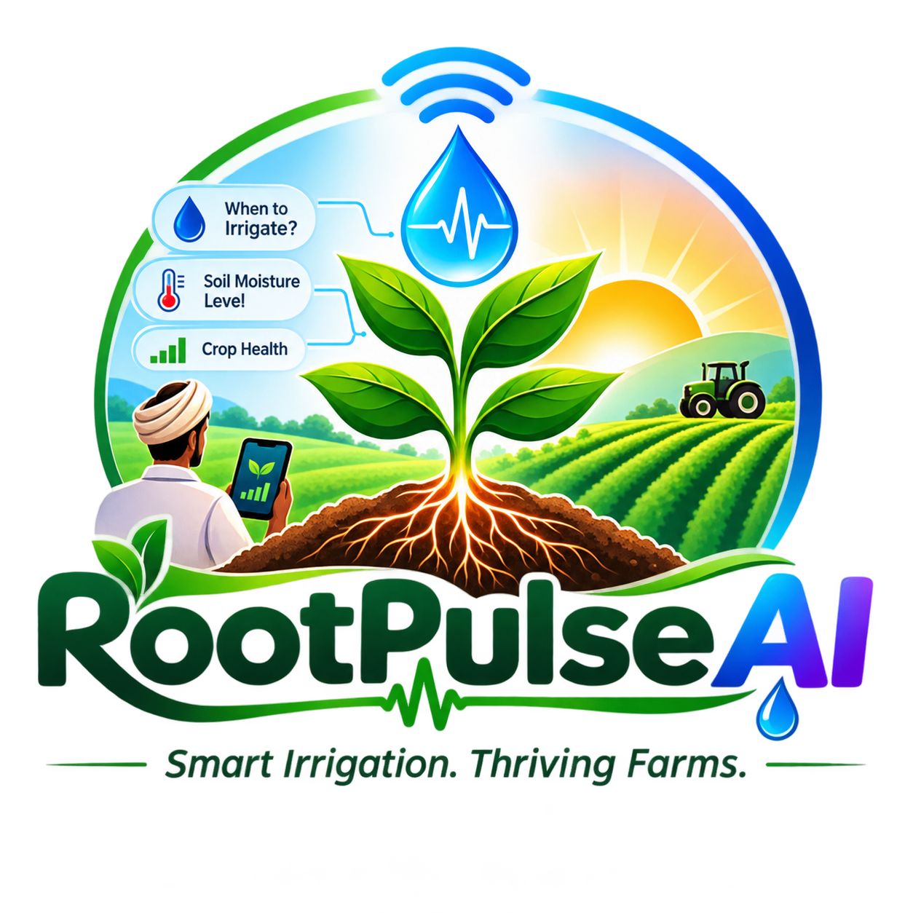
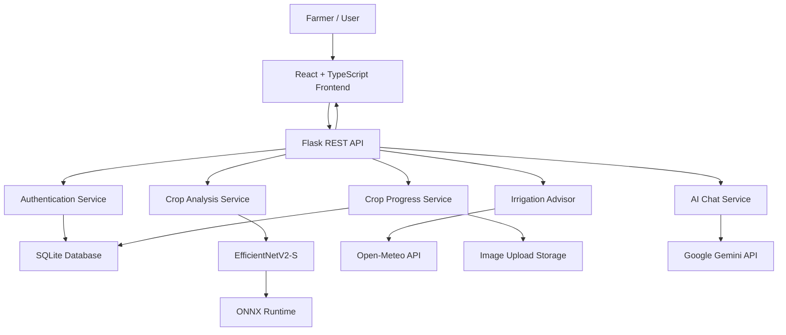

# 🌱 RootPulse AI
### AI-Powered Precision Agriculture & Smart Farming Platform

<p align="center">
  <b>Smarter Irrigation. Healthier Crops. Sustainable Agriculture.</b>
  <br/>
  Turning agricultural data into intelligent farming decisions.
</p>

<p align="center">
  
</p>

<p align="center">
  
  
  
  
  
</p>

---

## 🌾 Overview

**RootPulse AI** is an AI-powered precision agriculture platform designed to help farmers make smarter, data-informed decisions about crop health, irrigation, and crop development.

Traditional farming often depends on manual observation and experience. RootPulse AI brings together machine learning, weather intelligence, and agricultural assistance in one platform to make essential farming insights more accessible.

From identifying potential crop diseases through leaf images to generating irrigation recommendations based on soil moisture and weather conditions, RootPulse AI aims to reduce guesswork and support more informed farming practices.

Built as a software-based precision agriculture solution for the **Green Planet Challenge – GP-02: AI-Based Precision Irrigation Advisory**.

> 🌱 Less guesswork. Smarter decisions. Better farming.

## ✨ Key Features

### 🔬 1. AI-Powered Crop Disease Detection

Identify potential crop health issues by uploading a leaf image.

- Upload JPG, JPEG, and PNG images.
- AI-based leaf classification using EfficientNetV2-S.
- ONNX Runtime inference for model execution.
- Identifies healthy leaves and supported disease conditions.
- Provides explanations and suggested next steps.
- Includes uncertain prediction handling.
- Displays recent crop analysis results for authenticated farmers.


### 💧 2. Smart Irrigation Advisor

Make more informed irrigation decisions using crop, soil, and weather context.

Farmers can provide:

- Crop type
- Growth stage
- Soil type
- Manually measured soil moisture
- Location
- Field size
- Additional farming notes

The advisory engine evaluates the supplied information and generates:

- Irrigation recommendations
- Soil moisture status
- Weather conditions
- Rainfall forecast context
- Rain-smart alerts
- Explanation of recommendation factors
- Suggested next actions

**Recommendation statuses:**

| Status | Meaning |
|---|---|
| 💧 Irrigate | Moisture conditions indicate irrigation may be needed |
| ⏳ Wait | Current conditions suggest waiting |
| ⚠️ Review Conditions | More information or manual assessment is needed |

Weather information is retrieved through Open-Meteo APIs.

### 🌦️ 3. Weather Intelligence

RootPulse AI integrates weather information to provide additional context for irrigation decisions.

Features include:

- Location-based weather lookup
- Temperature information
- Relative humidity
- Current precipitation
- Next 24-hour rainfall forecast
- Maximum precipitation probability
- Rain-smart irrigation alerts

Weather data is provided by the Open-Meteo geocoding and forecast services.

### 📈 4. Crop Progress Tracking

Track crop development through dated photographs.

Features include:

- Create and manage crop profiles.
- Assign optional field names.
- Upload crop progress photographs.
- Record photo capture dates.
- Add observation notes.
- View chronological crop timelines.
- Compare two progress photographs side by side.
- Access previously uploaded crop progress images.

Crop progress records are stored in SQLite, while original photographs are stored in the backend uploads directory.

### 🤖 5. Ask Your Crop – AI Farming Assistant

An AI-powered agricultural assistant designed to make farming information easier to access.

Features include:

- Ask agriculture-related questions.
- Receive AI-generated farming guidance.
- Multilingual interaction.
- English, Tamil, and Hindi support.
- Optional saved crop context.
- Recent farmer observations as additional context.

Powered by Google's Gemini API through the Google GenAI Python SDK.

The assistant can use saved crop type, field name, and recent farmer notes when available.

### 🔐 6. Farmer Authentication & Account Recovery

RootPulse AI includes an authentication system for individual farmers.

Features include:

- Farmer registration
- Secure login and logout
- Case-insensitive unique usernames
- Password hashing
- HttpOnly session cookies
- Session-based authentication
- Password recovery questions
- Secure recovery token generation
- Expiring, single-use recovery tokens
- Rate-limited recovery attempts

Farmer-owned crop profiles and progress photographs are protected through ownership checks.

### 📊 7. Smart Farmer Dashboard

A centralized dashboard for accessing the platform's main capabilities.

Includes:

- Farm overview
- Crop-related information
- Weather context
- Crop analysis access
- Irrigation advisory access
- Crop progress management
- AI farming assistant navigation

Dashboard overview figures are illustrative rather than verified live farm measurements.

---

## 🛠️ Technology Stack

### Frontend

| Technology | Purpose |
|---|---|
| React 18 | User interface development |
| TypeScript | Type-safe application development |
| Vite | Development server and build tooling |
| Tailwind CSS | Utility-first styling |
| React Router | Application navigation |
| Axios | Frontend API communication |
| Recharts | Data visualization |
| Lucide React | Interface icons |

### Backend

| Technology | Purpose |
|---|---|
| Python 3.11+ | Backend development |
| Flask | REST API framework |
| Flask-CORS | Cross-origin request handling |
| SQLite | Persistent application database |
| SQLAlchemy | Database toolkit dependency |
| Werkzeug | Password hashing and security utilities |
| Pillow | Image validation and processing |
| python-dotenv | Environment configuration |

### Artificial Intelligence & External Services

| Technology | Purpose |
|---|---|
| EfficientNetV2-S | Crop disease classification |
| ONNX Runtime | Machine learning inference |
| Hugging Face Hub | Model repository and downloads |
| Google Gemini | AI agricultural assistant |
| Open-Meteo | Weather and forecast information |

---

## 🏗️ System Architecture

RootPulse AI follows a frontend-backend architecture.



### Application Workflow

1. Farmers access the React-based application.
2. The frontend communicates with Flask through REST APIs.
3. Flask validates requests and handles authentication.
4. Crop images are processed using the machine learning model.
5. Irrigation requests are evaluated using supplied crop and moisture information.
6. Weather context is retrieved when a location is provided.
7. Crop profiles and progress photographs are stored.
8. The AI assistant generates responses through Gemini when configured.
9. Results are returned to the frontend for presentation.

---

## 📂 Project Structure

```text
RootPulseAI/
│
├── backend/
│   │
│   ├── app/
│   │   ├── __init__.py
│   │   ├── auth.py
│   │   ├── config.py
│   │   │
│   │   ├── routes/
│   │   │   ├── auth.py
│   │   │   ├── analyze.py
│   │   │   ├── chat.py
│   │   │   ├── health.py
│   │   │   ├── irrigation.py
│   │   │   └── progress.py
│   │   │
│   │   ├── services/
│   │   │   ├── analysis_store.py
│   │   │   ├── chat_assistant.py
│   │   │   ├── crop_model.py
│   │   │   ├── irrigation_advisor.py
│   │   │   ├── progress_store.py
│   │   │   └── weather.py
│   │   │
│   │   └── models/
│   │
│   ├── data/
│   │   └── rootpulse.sqlite3
│   │
│   ├── models/
│   │   └── hf-cache/
│   │
│   ├── uploads/
│   │
│   ├── tests/
│   ├── requirements.txt
│   ├── run.py
│   └── .env.example
│
├── frontend/
│   │
│   ├── public/
│   │   └── images/
│   │
│   ├── src/
│   │   ├── auth/
│   │   ├── components/
│   │   ├── hooks/
│   │   ├── pages/
│   │   │   ├── Dashboard.tsx
│   │   │   ├── CropAnalysis.tsx
│   │   │   ├── IrrigationAdvisor.tsx
│   │   │   ├── CropProgress.tsx
│   │   │   ├── AskYourCrop.tsx
│   │   │   └── AuthPages.tsx
│   │   │
│   │   ├── preferences/
│   │   ├── services/
│   │   ├── types/
│   │   ├── App.tsx
│   │   └── main.tsx
│   │
│   ├── package.json
│   ├── vite.config.ts
│   └── .env.example
│
├── .gitignore
└── README.md
```

---

## 🚀 Installation & Setup

Follow these instructions to run RootPulse AI locally.

### Prerequisites

Make sure you have installed:

- Python 3.11 or later
- Node.js and npm
- Git
- A code editor such as Visual Studio Code
- Internet connection for external APIs and initial model download

### 1. Clone the Repository

```bash
git clone https://github.com/YOUR_USERNAME/RootPulseAI.git
```

Navigate into the project:

```bash
cd RootPulseAI
```

### 2. Backend Setup

Create a Python virtual environment:

**Windows:**

```powershell
py -3.11 -m venv backend\.venv
```

Activate it:

```powershell
.\backend\.venv\Scripts\Activate.ps1
```

**Linux / macOS:**

```bash
python3 -m venv backend/.venv
source backend/.venv/bin/activate
```

Install backend dependencies:

```bash
pip install --upgrade pip
pip install -r backend/requirements.txt
```

### 3. Configure Environment Variables

Create the backend environment file.

**Windows:**

```powershell
Copy-Item backend/.env.example backend/.env
```

**Linux / macOS:**

```bash
cp backend/.env.example backend/.env
```

Configure the required values in `backend/.env`.

```env
PORT=5000

GEMINI_API_KEY=your_google_gemini_api_key_here
GEMINI_MODEL=gemini-3.5-flash

SESSION_SECRET_KEY=your_random_secret_key
SESSION_COOKIE_SECURE=false
```

Generate a secure session secret using:

```bash
python -c "import secrets; print(secrets.token_hex(32))"
```

Copy the generated value into `SESSION_SECRET_KEY`.

**Important:**
- Gemini API access is optional for the rest of the application.
- Without a Gemini API key, the AI chat feature returns a not-configured response.
- Never expose API keys in frontend environment variables.
- Set `SESSION_COOKIE_SECURE=true` when deploying over HTTPS.

### 4. Start the Backend

From the project root:

```bash
python backend/run.py
```

The Flask server starts at:

```text
http://localhost:5000
```

Verify backend availability:

```text
http://localhost:5000/api/health
```

### 5. Frontend Setup

Open a second terminal.

Navigate to the frontend directory:

```bash
cd frontend
```

Install dependencies:

```bash
npm install
```

Create the frontend environment file.

**Windows:**

```powershell
Copy-Item .env.example .env
```

**Linux / macOS:**

```bash
cp .env.example .env
```

Start the development server:

```bash
npm run dev
```

### 6. Access RootPulse AI

Open your browser:

```text
http://localhost:5173
```

<details>
<summary><b>Additional frontend commands</b></summary>

Build the frontend for production:

```bash
npm run build
```

Preview the production build:

```bash
npm run preview
```

</details>

---

## ⚙️ AI Model Integration

### Crop Disease Classification

RootPulse AI integrates the MIT-licensed **BiernyVR Crop Disease Classifier** from Hugging Face.

Model: EfficientNetV2-S

Repository:

https://huggingface.co/BiernyVR/crop-disease-classifier

Inference engine: ONNX Runtime.

The model is downloaded from a pinned repository revision when the first supported crop analysis is performed. It is then cached locally.

**Model processing workflow:**

```text
Upload Leaf Image
       |
       v
Image Validation
       |
       v
Image Preprocessing
       |
       v
EfficientNetV2-S
       |
       v
ONNX Runtime Inference
       |
       v
Prediction Evaluation
       |
       v
Crop Health Result
```

The backend evaluates prediction score and the margin between the top two classes. Low-confidence or ambiguous results are marked uncertain rather than presented as definitive diagnoses.

### Model Configuration

| Variable | Default | Description |
|---|---|---|
| `CROP_MODEL_REPO` | `BiernyVR/crop-disease-classifier` | Model repository |
| `CROP_MODEL_REVISION` | Pinned revision | Model version |
| `CROP_MODEL_MIN_SCORE` | `0.60` | Minimum raw prediction score |
| `CROP_MODEL_MIN_MARGIN` | `0.08` | Minimum top-class margin |

---

## 🌦️ Weather & Irrigation Integration

### Open-Meteo Integration

Weather information is retrieved through:

- Open-Meteo Geocoding API
- Open-Meteo Forecast API

No API key is required for the project's current non-commercial hackathon usage.

An internet connection is required.

### Irrigation Configuration

The advisory uses configurable illustrative moisture thresholds and growth-stage adjustments.

| Variable | Default |
|---|---:|
| `IRRIGATION_MOISTURE_LOW` | 30 |
| `IRRIGATION_MOISTURE_HIGH` | 70 |
| `IRRIGATION_SEEDLING_ADJUSTMENT` | 5 |
| `IRRIGATION_VEGETATIVE_ADJUSTMENT` | 0 |
| `IRRIGATION_FLOWERING_ADJUSTMENT` | 5 |
| `IRRIGATION_FRUITING_ADJUSTMENT` | 5 |
| `IRRIGATION_MATURITY_ADJUSTMENT` | -5 |
| `RAIN_SMART_MIN_MM` | 5 |
| `RAIN_SMART_MIN_PROBABILITY` | 60 |
| `OPEN_METEO_TIMEOUT_SECONDS` | 6 |

These settings can be adjusted in `backend/.env`.

---

## 🔌 API Documentation

The Flask backend exposes REST endpoints under `/api`.

### Health

| Method | Endpoint | Description | Authentication |
|---|---|---|---|
| GET | `/api/health` | Backend health check | Public |

### Authentication

| Method | Endpoint | Description |
|---|---|---|
| POST | `/api/auth/register` | Register a farmer |
| POST | `/api/auth/login` | Authenticate a farmer |
| POST | `/api/auth/logout` | End current session |
| GET | `/api/auth/me` | Get authenticated farmer |
| POST | `/api/auth/recovery/setup` | Configure recovery answers |
| POST | `/api/auth/recovery/questions` | Retrieve recovery questions |
| POST | `/api/auth/recovery/verify` | Verify recovery answers |
| POST | `/api/auth/recovery/reset` | Reset account password |

### Crop Analysis

| Method | Endpoint | Description |
|---|---|---|
| POST | `/api/analyze` | Analyze uploaded crop leaf |
| GET | `/api/analyze/recent` | Retrieve recent analyses |

### Irrigation & Weather

| Method | Endpoint | Description |
|---|---|---|
| POST | `/api/irrigation/recommend` | Generate irrigation advisory |
| GET | `/api/weather` | Weather lookup |

### Crop Progress

| Method | Endpoint | Description |
|---|---|---|
| GET | `/api/progress/crops` | List farmer crops |
| POST | `/api/progress/crops` | Create crop profile |
| GET | `/api/progress/summary` | Retrieve progress summary |
| POST | `/api/progress/upload` | Upload progress photograph |
| GET | `/api/progress/<crop_id>` | Retrieve crop timeline |
| GET | `/api/progress/images/<filename>` | Retrieve authorized crop image |

### AI Assistant

| Method | Endpoint | Description |
|---|---|---|
| POST | `/api/chat` | Send a question to the AI farming assistant |

**Note:** Farmer-specific data endpoints require an authenticated session where applicable. The API uses JSON responses and multipart form data for image uploads.

---

## 🗄️ Database & Storage

RootPulse AI uses SQLite for local persistent storage.

Database location:

```text
backend/data/rootpulse.sqlite3
```

The database is initialized automatically when the Flask application starts.

It stores application data such as:

- Farmer accounts
- Authentication information
- Crop profiles
- Crop progress photographs metadata
- Recent crop analysis results
- Recovery-related records

Uploaded crop progress images are stored separately:

```text
backend/uploads/
```

The backend uses ownership checks to prevent farmers from accessing another farmer's crop records and associated progress photographs.

---

## 🔐 Security Considerations

RootPulse AI incorporates several security measures:

- Password hashing using Werkzeug.
- HttpOnly session cookies.
- SameSite cookie configuration.
- Server-side session authentication.
- Farmer-specific resource ownership checks.
- Input validation for uploaded images.
- Image upload size restrictions.
- Recovery token expiration.
- Single-use recovery tokens.
- Rate limiting on password recovery attempts.
- Restricted CORS origins.
- API keys managed through backend environment variables.

For production deployment, configure HTTPS, secure session cookies, a strong secret key, database backups, and appropriate upload-storage protection.

---

## ⚠️ Current Limitations & Scope

RootPulse AI is an evolving precision agriculture project. Some features are implemented as initial advisory capabilities and should not be confused with fully validated agricultural systems.

1. **Crop diagnosis:** The classifier supports tomato, potato, and maize. Its reported PlantVillage-based evaluation does not establish reliability on real-world field images.
2. **Prediction confidence:** Model confidence is a raw softmax score, not a calibrated probability of correctness.
3. **Irrigation thresholds:** Moisture thresholds and rainfall triggers are illustrative and require agronomic validation.
4. **Sensor integration:** The current irrigation advisor uses manually entered soil moisture rather than live IoT sensor readings.
5. **Water calculation:** The system does not currently calculate exact irrigation volumes.
6. **Weather dependency:** Weather information requires internet connectivity and an available external service.
7. **Crop progress:** Crop analysis results are not yet linked automatically to crop progress records.
8. **AI chat history:** Conversations remain in browser memory and are not persistently stored.
9. **Dashboard statistics:** Some dashboard overview values are illustrative.
10. **Production readiness:** The current implementation is a development/hackathon project and requires further testing and validation before real-world agricultural deployment.

---

## 🔮 Future Enhancements

The long-term vision for RootPulse AI includes:

- 📡 IoT-based real-time soil moisture monitoring.
- 🌧️ Advanced weather-based irrigation prediction.
- 🧠 Improved crop disease classification with field-image datasets.
- 📍 GPS-based farm mapping.
- 🚜 Crop-specific irrigation scheduling.
- 📊 Advanced farm analytics and reporting.
- 🔔 Real-time alerts and notifications.
- 🌐 Additional regional language support.
- 📱 Mobile-friendly and offline-first farming experience.
- 🗺️ Multi-field farm management.
- 🌱 Personalized crop recommendations.

---

## 🎯 Project Vision

Our goal is to make intelligent agriculture more accessible to farmers.

By combining artificial intelligence, weather intelligence, and digital crop monitoring, RootPulse AI aims to support better farming decisions, encourage responsible water usage, and contribute to sustainable agricultural development.

**Technology should not replace farmers' experience. It should empower it.**

---

## 🤝 Contributing

Contributions, ideas, and suggestions are welcome!

To contribute:

1. Fork this repository.
2. Create a feature branch.

```bash
git checkout -b feature/your-feature-name
```

3. Commit your changes.

```bash
git commit -m "Add: your feature description"
```

4. Push your branch.

```bash
git push origin feature/your-feature-name
```

5. Open a Pull Request describing your changes.

Please ensure that your contributions do not include API keys, personal farmer information, uploaded photographs, or local database files.

---

## 📜 License & Credits

This project integrates third-party technologies and services, including:

- [React](https://react.dev/)
- [Flask](https://flask.palletsprojects.com/)
- [ONNX Runtime](https://onnxruntime.ai/)
- [Hugging Face](https://huggingface.co/)
- [BiernyVR Crop Disease Classifier](https://huggingface.co/BiernyVR/crop-disease-classifier)
- [Google Gemini](https://ai.google.dev/)
- [Open-Meteo](https://open-meteo.com/)

The integrated crop disease classifier is MIT-licensed. Refer to its model repository for its license and dataset details.

The overall RootPulse AI repository does not currently declare a separate project license. Add a `LICENSE` file before distributing it under a particular open-source license.

---

<p align="center">

## 🌱 ROOTPULSE AI

### Give Every Crop a Smarter Future.

**Built with 💚 for smarter and sustainable agriculture.**

*Grow Smarter. Save Water. Cultivate Tomorrow.*

</p>
